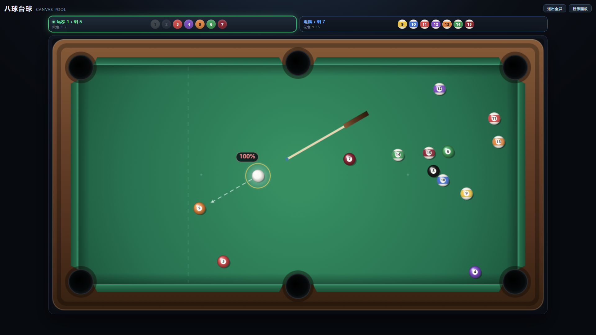
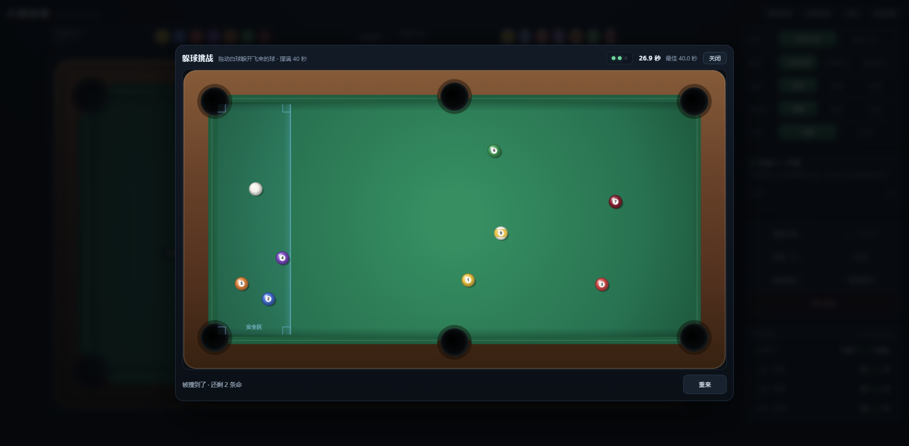
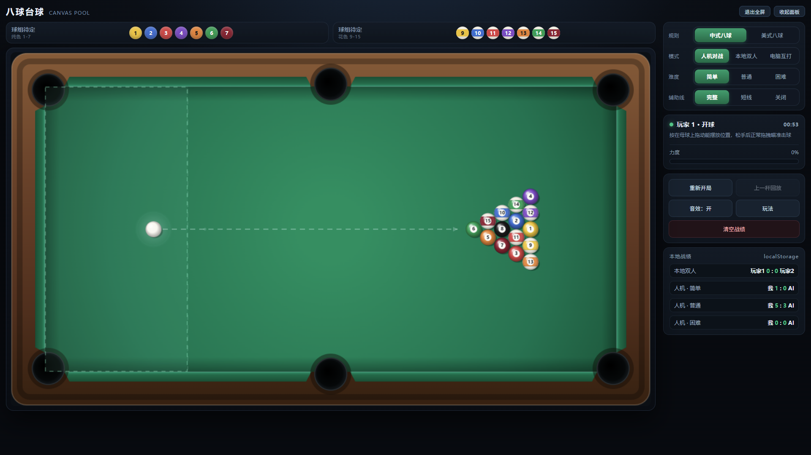
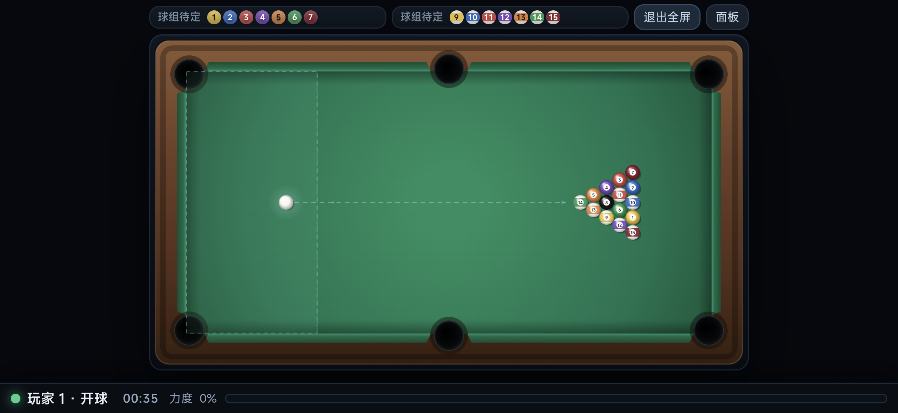

# 中式 / 美式八球 · Canvas Pool

纯前端的八球台球小游戏：Canvas 绘制 + 原生 JavaScript 物理，无框架、无构建、无后端、无外部资源。
**双击 `index.html` 就能玩**，断网也行，Windows / macOS 浏览器、手机平板网页都适配。

- 两套规则可切：**中式八球（默认）** / 美式八球，袋口松紧、自由球范围、开球有效性都跟着变
- 一方是本地双人对战，另一方是三档难度的电脑对手
- 完整八球规则：开球定组、手中球、黑八（美式需指定袋）、犯规判罚
- 台面上方的球号条实时显示双方球组归属与剩余数量

> **想从零学着自己做一个？** 附带一套 23 章的入门教程（假定你没写过 JavaScript）：[`docs/tutorial/00-导读.md`](./docs/tutorial/00-导读.md)，从"第一个网页"一路做到"能打、有规则、有对手、手机上也能玩"，最后一章番外讲怎么加一个独立的跳球小玩法。
> 想看成一整本书的感觉，直接双击 [`docs/tutorial/index.html`](./docs/tutorial/index.html)，左侧就是目录，章节可点可翻。

电脑端：


打球：



跳球挑战：



设置面板：



移动端：



## 快速开始

1. 双击 `index.html`（或拖进浏览器）；
2. 进页面不会弹窗挡着台面：顶部只闪一条「比赛开始 · 玩家 1 开球 · 按住台面往回拉即可出杆」，第一次玩台面上还会画一条绿色「往回拉」箭头，打出一杆后永久消失；
3. 电脑上用鼠标、手机上用手指在台面按下并拖动瞄准，松开即出杆；
4. 需要换模式或难度，点右侧面板最上方的「对局设置」卡。

## 操作方式

| 操作                 | 说明                                                                                                                                                                                                                                                                                                                                                                                                                                                                                        |
| -------------------- | ------------------------------------------------------------------------------------------------------------------------------------------------------------------------------------------------------------------------------------------------------------------------------------------------------------------------------------------------------------------------------------------------------------------------------------------------------------------------------------------- |
| 瞄准                 | 在台面上按下并拖动，**拖拽方向与击球方向相反**（像把球杆往后拉）                                                                                                                                                                                                                                                                                                                                                                                                                            |
| 力度                 | 拖拽距离越远力度越大（约 84 逻辑像素就到满力，是原来的 1/3），右侧力度条实时显示百分比，**拖拽时母球旁也会浮出自己的百分比**（画在垂直于击球方向的一侧，手指和瞄准虚线都挡不到；贴库时自动换到空的一边）                                                                                                                                                                                                                                                                                    |
| 击球                 | 松开鼠标 / 手指即出杆，所有球静止后才允许下一杆                                                                                                                                                                                                                                                                                                                                                                                                                                             |
| 开球摆放             | 开球时母球可在开球区内先拖动摆好：**按住母球本体拖动**（按在球上才算摆放），松手即完成摆放，之后正常拖拽瞄准                                                                                                                                                                                                                                                                                                                                                                                |
| 手中球               | 犯规后获得手中球，按在母球上拖到合适位置松手完成摆放：中式可放全台任意空位，美式只能放回开球区。**母球旁会浮一个小药丸标签「按住母球拖动摆位」**（默认贴在球下方，靠近台边或下方有球时自动翻到上方，字号按画布缩放反算；一按下就消失，电脑回合/弹窗时不出现）。**摆位时辅助线会自动指向离母球最近的可打球**（定组后只算己方球，清完球只剩黑八），拖到哪儿就重新找一次，不会指空处。拖动途中若被系统打断（切窗口、系统手势、窗口失焦），这次拖拽直接作废、母球回原位，不会在没松手时自己落位 |
| 黑八指定袋（仅美式） | 美式八球轮到自己打黑八时，点击目标袋口指定，须打进指定袋才算赢；中式八球不用选，进任意袋都算赢                                                                                                                                                                                                                                                                                                                                                                                              |

台面上的虚线只指**母球出发方向**（`完整` 档连同一处碰撞点，`短线` 档只有一小段方向，`关闭` 档不画），不做碰撞后的多段轨迹预测。

轮到玩家、手还没按下时，母球外面会有一圈很慢的呼吸光（约 3.8 秒一轮，亮度压得很淡，半径只轻轻外扩 4px），方便在满台球里一眼找到白球；开球、犯规后的手中球都是同一档，不做加强。一按下瞄准或摆位、出杆、电脑回合，这圈光立刻消失，静止画面不会一直动。

处于手中球（可以摆放母球）时，白球外面还有**一圈淡绿提示环**：2.8 秒一轮，淡入淡出走正弦（不会硬起硬停），半径从 18px 慢慢散到 26px，最亮时透明度只有 0.26，看起来像轻轻呼一口气而不是快速闪动。按下去拖动摆位后这圈环会跟着母球走。

## 手机上的布局

| 形态                             | 布局                                                                                                                                                                                     |
| -------------------------------- | ---------------------------------------------------------------------------------------------------------------------------------------------------------------------------------------- |
| 竖屏（宽 ≤ 940px）               | 台面在上、设置与战绩面板在下，整页纵向滚动；适合改设置、看战绩                                                                                                                           |
| 横屏（高 ≤ 560px 且宽 ≤ 1000px） | 台面独占一屏、等比放到最大：页头、按钮卡、战绩卡收起，顶部只留一条压扁的球号条，底部一条固定状态条（轮到谁 + 计时 + 力度），右上「面板」按钮点开是右侧抽屉，选完任意一项或点遮罩自动收起 |

横屏这套只靠 CSS 媒体查询（`orientation:landscape` + `max-height:560px` + `max-width:1000px`）实现，不改游戏逻辑：画布位图仍是 1120×620，指针坐标按 `getBoundingClientRect()` 实时换算，所以放大后触摸瞄准自动对齐；抽屉的开合逻辑在 `js/hud.js` 末尾。

**横屏推荐用全屏打**：横屏时球号条右端除了「面板」还有一个「全屏」按钮（浏览器不支持全屏——例如 iPhone Safari——就自动隐藏，不会留个点了没反应的键）。进全屏会把地址栏那部分也让给台面，进出全屏由 `fullscreenchange` 同步按钮文案并重绘。

**竖屏第一次进来会给一条轻提示**「横屏 + 全屏，打起来更顺手」（在球号条和台面之间的小横条，不弹窗、不挡台面）。这条提示**每次打开页面都会出现**，点「知道了」只关掉本次打开（转过屏后本次也不再出现），不写 `localStorage`，所以刷新回来照样能看到——新用户不会因为一次误点就再也见不到。

**桌面端的右侧面板可以收起**：页头右上角有个「收起面板 / 显示面板」按钮，按钮状态会记在 `localStorage` 的 `eightball.panelShow.v1`，下次打开还是上次的样子（默认显示）。收起后整块面板让位给台面（1440×900 实测台面从 1036px 宽到 1261px，约 +22%）。窄屏（≤940px）下面板本来就在台面下方，按钮会自动隐藏；手机横屏用细带上的「面板」抽屉按钮。

**全屏**：页头右上角有「全屏」按钮（手机横屏细带上那个是同一个功能，共用一套逻辑），点一下进浏览器原生全屏，按钮变成「退出全屏」，按 `Esc` 也能退。全屏后浏览器标签栏 / 地址栏 / 任务栏让出的高度会让台面跟着变大（台面宽度本来就按可视高度 `100dvh` 反算），例如 1440 宽屏上收起面板进全屏，台面能从约 1060px 长到 1261px。浏览器不支持 `requestFullscreen` 时按钮自动不显示。

## 对局模式与电脑难度

设置项集中在右侧面板最上方的「对局设置」卡：第一行「规则」（中式八球 / 美式八球），第二行「模式」（人机对战 / 本地双人 / 电脑互打，**默认进人机对战**），第三行「难度」（默认简单），第四行「辅助线」；「难度」行在本地双人模式下隐藏（本地对战不需要），切到「电脑互打」会变成「电脑 1」「电脑 2」两行难度并多出「暂停观战」按钮。切换模式或规则会直接重新摆球开局，辅助线档位只影响画法、不重开。

- **本地双人轮流**：同一台设备两人交替击球（玩家 1 / 玩家 2）。
- **人机对战**：玩家 1 对电脑，三档难度分别是
  - 简单：瞄准误差约 6°、力度误差 22%，只有 50% 概率认真找角度，其余随手一杆；
  - 普通：误差 2.2° / 10%，85% 概率规划线路；
  - 困难：误差 0.6° / 3%，100% 规划线路，几乎不失误。
- **电脑互打（观战）**：两边回合都交给电脑，双方难度可以分别设置；设置卡底部的「暂停观战 / 继续观战」可随时停下，看完一杆想接着看再点一次即可（暂停时本局计时也停表）。观战局只图个乐，胜负**不计入本地战绩**。

AI 回合会锁住鼠标与触摸输入（`state.locked`），且 AI 只通过和玩家同一套物理接口出杆，规则上不占任何便宜；电脑互打时双方共用这套逻辑，只是把 `isAIPlayer(turn)` 判断放到了两边。

## 规则实现（中式八球 / 美式八球）

两套规则 95% 一样（清组 → 打黑八、开球定组、犯规判罚流程完全相同），差异只有下面五处，切换在设置卡「规则」行，选择存 `localStorage`：

| 差异点             | 中式八球（默认）                                                     | 美式八球                     |
| ------------------ | -------------------------------------------------------------------- | ---------------------------- |
| 袋口               | 更紧一档（`POCKET_R_CN` 29 / `CAPTURE_R_CN` 23）                     | 更宽容（32 / 26）            |
| 犯规后手中球       | **自由球，可摆全台任意空位**                                         | 只能摆回开球区               |
| 开球有效性         | 至少 1 颗球进袋，或至少 4 颗目标球碰库，否则算开球犯规（对手手中球） | 不校验                       |
| 开球时 8 号进袋    | 不算输，8 号摆回置球点继续                                           | 按「没清完球就打进黑八」判负 |
| 打黑八要不要指定袋 | **不指定，进任意一个袋都算赢**                                       | 必须先点袋口指定，进错袋判负 |

两套规则共用的部分：

1. **开球**：母球摆在开球区（开球线左侧），往球堆方向击打；两套规则开球阶段都只能在开球区摆母球。
2. **定组**：开球或后续首个合法进球后锁定球组；同一杆同时打进纯色与花色时，弹窗让玩家自选（AI 自动选台面剩余更少的一组）。
3. **清球**：必须先打完自己组的 7 颗球，才有资格打 8 号黑八。
4. **黑八判负**：没清完自己的球就打进黑八 / 打黑八时母球落袋（两套规则都算）；「黑八进错袋」只在美式成立。
5. **普通犯规**：
   - 母球首个碰到的是对方球，或空杆没碰到任何球；
   - 母球落袋（非黑八阶段）。

   犯规后状态栏点名「谁犯规 · 什么原因」，对手获得**手中球**，摆放范围按上表区分。

6. **回合流转**：只有打进**自己组**的球才继续击球；只进了对方的球不算犯规，但这一杆结束、换对手击球；没进球或犯规同样换对手。

## 功能一览

- **规则切换**（右侧设置卡「规则」行）：`中式八球`（默认）/ `美式八球`，五处差异见上一节；选择存 `localStorage`，换规则直接重开一局
- **球组 / 球号条**：台面上方一排小球，左侧纯色 1-7、右侧花色 9-15；定组后在标题处标出归属与剩余数量（玩家 1 绿、玩家 2 蓝，当前击球方高亮），已进袋的球淡出
- **状态提示**：谁在击球 / 目标球组 / 黑八指定袋（仅美式）/ 犯规方与原因。台面上方的浮层提示条**按字数自动定时长**（`clamp(1800 + 150×字数, 3000, 8000)` ms：短句 3 秒保底，20 字约 4.8 秒，40 字以上 8 秒封顶），长文案自动换行完整显示不截断；点一下提示条可立刻收起，出杆时也会自动关掉
- **新手引导（不挡操作）**：进页面只在顶部闪一条「比赛开始 · 谁开球 · 按住台面往回拉即可出杆」，不弹窗；第一次玩时台面上还会画一条绿色箭头 + 「按住台面往回拉，松手出杆」，真正打出一杆就永久隐藏（`localStorage` 记住）。字画在 canvas 里，字号按画布缩放反算，手机上也不会小到看不清；摆球阶段、电脑回合不显示
- **玩法卡片**：右侧「玩法」按钮随时可打开，标题按模式 / 难度自动换（本地双人、人机对战 · 难度 X、电脑互打），要点包含瞄准、力度、开球摆位、黑八（美式要指定袋、中式不用选），最后一条跟着当前规则实时换文案；打开时暂停本局计时并锁住击球，点「知道了」关掉继续打
- **辅助线三档**（右侧设置卡里的「辅助线」行）：`完整` 虚线一直画到首个碰撞点、带起点光点与终点箭头；`短线` 只画母球出发方向约 132 逻辑像素的一小段、末端渐隐，不给碰撞点与终点（留方向、去结果）；`关闭` 什么都不画，只靠球杆判断角度。选择存 `localStorage`，刷新记得住；辅助线只在**拖动时**出现（拖拽瞄准或按住母球摆位都算），空闲不按就完全消失，不会在台面上留一条旧方向
- **力度条**：实时百分比，颜色从绿到红
- **本局计时**：夹在台面上方两组球号条**中间**的 `mm:ss` 小表（16px、`tabular-nums` 防跳秒、两侧各一条淡竖线；左右两组球号对称让位，所以它正好压在台面中轴线上，右侧面板收起/展开都不会错位），胜利弹窗另外给出「本局用时 X 分 X 秒」；电脑互打暂停观战时会停表、数字转橙。手机竖屏压到 13px / 46px 宽保住 7 颗球号不裁；手机横屏球号条太窄，这枚表改挂到底部状态条右端（`#barClock`，桌面端隐藏）。右侧状态卡只留「谁在击球 / 目标球组」与力度条，不再重复显示计时
- **上一杆回放**：每杆结束后可回放这一杆的完整运动过程（60fps 采样球位，回放完自动回到瞄准）
- **跳球挑战**（独立小玩法，页头「跳球挑战」或面板里同名按钮进入）：浮层里单开一张台面，每关排成「母球 → 挡球 → 目标球 → 指定袋口」，目标球摆在袋口前 70–195（越靠外越难），**跳过挡球、把目标球打进那只指定的袋才算过**（袋口一圈金色脉冲环，目标球到袋口一条淡金虚线指着路）。三关是**递进难度**，两条腿一起加：一条管「算不准」（偏角 15° / 25°），一条管「没退路」（杆数一路收紧、挡球一颗颗加）。第 1 关挡球 1 颗、正对袋口共线、不限杆数（教学）；第 2 关挡球 3 颗、袋口偏 15°、**2 杆内过**；第 3 关挡球 4 颗、袋口偏 25°、**3 杆内过**。偏角关会在目标球旁画一个**蓝色虚线假想圈**（圈心一个小点）——那是母球该停的位置，白球滚进圈里目标球才会朝袋口走；共线的第 1 关不画。页头有一枚「**瞄准圈 开 / 关**」小开关，它管的是**所有「结论类」提示**——开着时：蓝色假想圈 + 圈心点、拖拽时的落点圈（可行泛绿 / 不可行泛红）、挡球上「这颗跳不过去」的红圈红叉、弧线变红、底部「这杆能过 / 过不去」；关掉后这些圆圈和判断**全部收起**，只剩一条不变红的弧线加一句「力度 XX%」，行不行自己看落点判断；袋口金虚线、目标球和袋口上的金环（「这一关打哪个袋」的任务信息）一直留着。状态存 `localStorage`（`eightball.jump.hint.v1`）。拖拽瞄准（跟主玩法一样往回拉），预览会算出弧线高度并逐颗标出「这颗跳不过去」（挡球上打红圈红十字）、落点圈按整杆是否可行泛绿 / 泛红，底部顺带提示是「太矮」「偏近」还是「会飞过头」。母球起跳后机位俯视不变但球心抬高、球影缩小变淡，落地吃摩擦继续滚；没进袋的每一杆都会摆回本关原位、用剩下的杆数接着打（底部写明「还剩 N 杆」），杆数用完就只剩「重试」重开。只碰到球没进袋会说「往袋口那条线再压实一点」，撞挡球 / 母球自己掉袋 / 空跑各有对应提示。三关最好杆数存 `localStorage`（`eightball.jump.v1`）；浮层是覆盖式的，打开时主局计时暂停、关闭后回到原来那局，`Esc` 或点浮层空白处也能关掉。主对战的 `state`、主循环和规则一行都没动，跳球逻辑全在 `js/jump.js` 里自己一套
- **本地战绩**：`localStorage` 保存本地双人、人机简单 / 普通 / 困难的胜负场次，刷新不丢；清空战绩带二次确认
- **音效**：WebAudio 实时合成击球、碰球、落袋三种音效，开关状态同样持久化
- **胜利弹窗** + 一键重新开局
- **响应式**：Canvas 恒按 1120:620 等比缩放不拉伸；宽屏下球桌铺满可用宽度（同时受窗口高度约束，不会竖向滚动），右侧面板贴窗口右边；窄屏按钮自动换行，竖屏面板下移、横屏面板右移

## 物理与判定

简化刚体模型，够用且稳定：

| 项       | 做法                                                                                               |
| -------- | -------------------------------------------------------------------------------------------------- |
| 积分     | 固定步长 1/240s 子步累积，帧率无关                                                                 |
| 球球碰撞 | 等质量弹性碰撞，沿法线交换分量，重叠按质量对半推开                                                 |
| 库边     | 6 条线段（袋口处留 34px 缺口），线段端点天然形成袋角，所以**擦袋会弹回**而不是直接吃袋             |
| 落袋     | 球心进入袋口捕获半径才判进袋，袋口边缘仍会反弹；捕获半径按规则集取 `CAPTURE_R_CN` / `CAPTURE_R_US` |
| 摩擦     | 恒定滚动减速，低于静止阈值直接归零                                                                 |
| 限制     | 无塞、无扎杆、无跳球、无旋转                                                                       |

## 文件结构

```
canvas-billiards/
├── index.html        # 页面结构 + 外链 CSS / JS
├── css/
│   ├── base.css      # 变量、重置、body、标题栏
│   ├── layout.css    # 主区域、桌子列、画布容器与 canvas
│   ├── rack.css      # 台面上方球组 / 球号条
│   ├── panel.css     # 右侧面板：卡片、状态、力度、按钮、战绩
│   ├── overlay.css   # 画布浮层提示与胜利弹窗
│   └── responsive.css# 全部响应式断点
├── js/
│   ├── config.js     # 常量与几何定义
│   ├── util.js       # 通用工具函数
│   ├── state.js      # 游戏状态
│   ├── balls.js      # 球与球堆
│   ├── canvas.js     # Canvas 初始化与设备像素比
│   ├── render.js     # 台面渲染
│   ├── physics.js    # 物理引擎
│   ├── aim.js        # 瞄准线 / 球杆
│   ├── input.js      # 鼠标与触摸输入
│   ├── rules.js      # 击球流程与八球规则
│   ├── score.js      # 胜负判定与本地战绩
│   ├── ai.js         # 电脑对手（三档难度）
│   ├── sound.js      # WebAudio 音效
│   ├── replay.js     # 上一杆回放
│   ├── hud.js        # 状态提示、弹窗、按钮、球号条
│   ├── loop.js       # 主循环
│   └── main.js       # 启动
├── README.md
└── .gitignore        # 忽略系统垃圾文件、IDE 配置、日志与临时文件
```

脚本按上表顺序以普通 `<script>` 引入（不是 ES Module，所以 `file://` 直接双击也能跑），所有文件共享同一个全局作用域，只在 `main.js` 末尾调用一次 `boot()` 启动。

## 代码导读

一杆的生命周期大致是这条链路，改动时按它定位：

```
input.js     指针按下 / 拖动 → 记录瞄准方向与力度
aim.js       画瞄准线与球杆
rules.js     shoot() 把力度转成母球初速度，进入 shooting
physics.js   子步积分、球球碰撞、库边反弹、落袋判定，直到全部静止
rules.js     endShot() 结算这一杆：定组 / 犯规 / 手中球 / 连续进球 / 黑八判负
score.js     胜负记账并写入 localStorage
hud.js       刷新状态栏、力度条、球号条、弹窗
replay.js    需要时按帧回放这一杆
ai.js        AI 回合选球 → 规划 → 带误差出杆 → 释放输入锁
```

电脑互打走的是同一条链路，区别只在 `state.turn` 轮到哪一方都算电脑：`ai.js` 的 `maybeStartAI()` 会按 `isAIPlayer(turn)` 排给对应那一方，`endShot()` 结算完再接着排下一杆。

常用可调参数都在 `js/config.js`：`VIEW_W/VIEW_H`（逻辑画布 1120×620）、`TABLE`（台面 1000×500）、`BALL_R`（球半径）、`MAX_SPEED` / `ROLL_DECEL` / `STOP_SPEED`（运动手感）、`POCKET_R_CN` / `CAPTURE_R_CN`（中式袋口）、`POCKET_R_US` / `CAPTURE_R_US`（美式袋口）、`RAIL_GAP`（库边袋口缺口）、`MAX_DRAG`（拖拽满力距离，现 84 ≈ 原来的 1/3）、`AIM_SHORT_LEN`（辅助线「短线」档的长度）。
