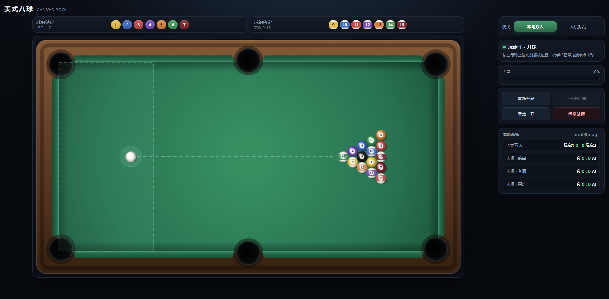

# 美式八球 · Canvas Pool

纯前端的美式八球台球小游戏：Canvas 绘制 + 原生 JavaScript 物理，无框架、无构建、无后端、无外部资源。
**双击 `index.html` 就能玩**，断网也行，Windows / macOS 浏览器、手机平板网页都适配。

- 一方是本地双人对战，另一方是三档难度的电脑对手
- 完整美式八球规则：开球定组、手中球、黑八指定袋、犯规判罚
- 台面上方的球号条实时显示双方球组归属与剩余数量



## 快速开始

1. 双击 `index.html`（或拖进浏览器）；
2. 电脑上用鼠标、手机上用手指在台面按下并拖动瞄准，松开即出杆；
3. 需要换模式或难度，点右侧面板最上方的「对局设置」卡。

## 操作方式

| 操作 | 说明 |
| --- | --- |
| 瞄准 | 在台面上按下并拖动，**拖拽方向与击球方向相反**（像把球杆往后拉） |
| 力度 | 拖拽距离越远力度越大，右侧力度条实时显示百分比 |
| 击球 | 松开鼠标 / 手指即出杆，所有球静止后才允许下一杆 |
| 开球摆放 | 开球时母球可在开球区内先拖动摆好：**按住母球本体拖动**（按在球上才算摆放），松手即完成摆放，之后正常拖拽瞄准 |
| 手中球 | 犯规后获得手中球，同样按在母球上拖到开球区内合适位置，松手完成摆放 |
| 黑八指定袋 | 轮到自己打黑八时，点击目标袋口指定，须打进指定袋才算赢 |

台面上只画一条虚线：**母球出发方向的瞄准线**（连同预测的首个碰撞点），不做碰撞后的多段轨迹预测。

## 对局模式与电脑难度

设置项集中在右侧面板最上方的「对局设置」卡：先选模式，再按模式出现对应的难度行（人机对战只有「难度」一行，电脑互打则有「电脑 1」「电脑 2」两行）；切换模式会直接重新摆球开局。

- **本地双人轮流**：同一台设备两人交替击球（玩家 1 / 玩家 2）。
- **人机对战**：玩家 1 对电脑，三档难度分别是
  - 简单：瞄准误差约 6°、力度误差 22%，只有 50% 概率认真找角度，其余随手一杆；
  - 普通：误差 2.2° / 10%，85% 概率规划线路；
  - 困难：误差 0.6° / 3%，100% 规划线路，几乎不失误。
- **电脑互打（观战）**：两边回合都交给电脑，双方难度可以分别设置；设置卡底部的「暂停观战 / 继续观战」可随时停下，看完一杆想接着看再点一次即可。观战局只图个乐，胜负**不计入本地战绩**。

AI 回合会锁住鼠标与触摸输入（`state.locked`），且 AI 只通过和玩家同一套物理接口出杆，规则上不占任何便宜；电脑互打时双方共用这套逻辑，只是把 `isAIPlayer(turn)` 判断放到了两边。

## 规则实现（美式八球）

1. **开球**：母球摆在开球区（开球线左侧），往球堆方向击打。
2. **定组**：开球或后续首个合法进球后锁定球组；同一杆同时打进纯色与花色时，弹窗让玩家自选（AI 自动选台面剩余更少的一组）。
3. **清球**：必须先打完自己组的 7 颗球，才有资格打 8 号黑八。
4. **黑八判负**（三种）：没清完自己的球就打进黑八 / 打黑八时母球落袋 / 黑八进错袋（指定袋口之外）。
5. **普通犯规**：
   - 母球首个碰到的是对方球，或空杆没碰到任何球；
   - 母球落袋（非黑八阶段）。

   犯规后状态栏点名「谁犯规 · 什么原因」，对手获得**手中球**，可在开球区内拖动摆放母球。
6. **回合流转**：进球则继续击球；没进球或犯规换对手。

## 功能一览

- **球组 / 球号条**：台面上方一排小球，左侧纯色 1-7、右侧花色 9-15；定组后在标题处标出归属与剩余数量（玩家 1 绿、玩家 2 蓝，当前击球方高亮），已进袋的球淡出
- **状态提示**：谁在击球 / 目标球组 / 黑八指定袋 / 犯规方与原因
- **力度条**：实时百分比，颜色从绿到红
- **上一杆回放**：每杆结束后可回放这一杆的完整运动过程（60fps 采样球位，回放完自动回到瞄准）
- **本地战绩**：`localStorage` 保存本地双人、人机简单 / 普通 / 困难的胜负场次，刷新不丢；清空战绩带二次确认
- **音效**：WebAudio 实时合成击球、碰球、落袋三种音效，开关状态同样持久化
- **胜利弹窗** + 一键重新开局
- **响应式**：Canvas 恒按 1120:620 等比缩放不拉伸；宽屏下球桌铺满可用宽度（同时受窗口高度约束，不会竖向滚动），右侧面板贴窗口右边；窄屏按钮自动换行，竖屏面板下移、横屏面板右移

## 物理与判定

简化刚体模型，够用且稳定：

| 项 | 做法 |
| --- | --- |
| 积分 | 固定步长 1/240s 子步累积，帧率无关 |
| 球球碰撞 | 等质量弹性碰撞，沿法线交换分量，重叠按质量对半推开 |
| 库边 | 6 条线段（袋口处留 34px 缺口），线段端点天然形成袋角，所以**擦袋会弹回**而不是直接吃袋 |
| 落袋 | 球心进入袋口捕获半径才判进袋，袋口边缘仍会反弹 |
| 摩擦 | 恒定滚动减速，低于静止阈值直接归零 |
| 限制 | 无塞、无扎杆、无跳球、无旋转 |

## 文件结构

```
canvas-billiards/
├── index.html        # 页面结构 + 外链 CSS / JS
├── css/
│   ├── base.css      # 变量、重置、body、标题栏
│   ├── layout.css    # 主区域、桌子列、画布容器与 canvas
│   ├── rack.css      # 台面上方球组 / 球号条
│   ├── panel.css     # 右侧面板：卡片、状态、力度、按钮、战绩
│   ├── overlay.css   # 画布浮层提示与胜利弹窗
│   └── responsive.css# 全部响应式断点
├── js/
│   ├── config.js     # 常量与几何定义
│   ├── util.js       # 通用工具函数
│   ├── state.js      # 游戏状态
│   ├── balls.js      # 球与球堆
│   ├── canvas.js     # Canvas 初始化与设备像素比
│   ├── render.js     # 台面渲染
│   ├── physics.js    # 物理引擎
│   ├── aim.js        # 瞄准线 / 球杆
│   ├── input.js      # 鼠标与触摸输入
│   ├── rules.js      # 击球流程与八球规则
│   ├── score.js      # 胜负判定与本地战绩
│   ├── ai.js         # 电脑对手（三档难度）
│   ├── sound.js      # WebAudio 音效
│   ├── replay.js     # 上一杆回放
│   ├── hud.js        # 状态提示、弹窗、按钮、球号条
│   ├── loop.js       # 主循环
│   └── main.js       # 启动
├── README.md
└── .gitignore        # 忽略系统垃圾文件、IDE 配置、日志与临时文件
```

脚本按上表顺序以普通 `<script>` 引入（不是 ES Module，所以 `file://` 直接双击也能跑），所有文件共享同一个全局作用域，只在 `main.js` 末尾调用一次 `boot()` 启动。

## 代码导读

一杆的生命周期大致是这条链路，改动时按它定位：

```
input.js     指针按下 / 拖动 → 记录瞄准方向与力度
aim.js       画瞄准线与球杆
rules.js     shoot() 把力度转成母球初速度，进入 shooting
physics.js   子步积分、球球碰撞、库边反弹、落袋判定，直到全部静止
rules.js     endShot() 结算这一杆：定组 / 犯规 / 手中球 / 连续进球 / 黑八判负
score.js     胜负记账并写入 localStorage
hud.js       刷新状态栏、力度条、球号条、弹窗
replay.js    需要时按帧回放这一杆
ai.js        AI 回合选球 → 规划 → 带误差出杆 → 释放输入锁
```

电脑互打走的是同一条链路，区别只在 `state.turn` 轮到哪一方都算电脑：`ai.js` 的 `maybeStartAI()` 会按 `isAIPlayer(turn)` 排给对应那一方，`endShot()` 结算完再接着排下一杆。

常用可调参数都在 `js/config.js`：`VIEW_W/VIEW_H`（逻辑画布 1120×620）、`TABLE`（台面 1000×500）、`BALL_R`（球半径）、`MAX_SPEED` / `ROLL_DECEL` / `STOP_SPEED`（运动手感）、`POCKET_R` / `CAPTURE_R` / `RAIL_GAP`（袋口宽容度）、`MAX_DRAG`（拖拽满力距离）。

## 设计取舍与边界

- **单文件还是分文件**：早期需求里"CSS / JS 分文件"与"所有代码写在一个 html"冲突，先按单文件实现，后来改成分文件；现在 `index.html` 只留结构与外链，仍然是双击即玩，不需要构建或本地服务器。
- **手中球限制在开球区**：按需求原文执行。想改成全台任意摆放，把 `js/rules.js` 里 `cueFits()` 的 `state.ballInHand` 边界判断放开即可。
- **刻意不做**：联机对战、碰撞后轨迹预测、整局长时间回放、分数导出、贴库球 / 推杆等职业判罚、双指缩放旋转手势。
